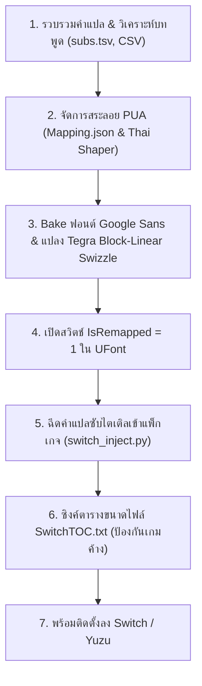

# Batman: Arkham Asylum - Nintendo Switch Thai Mod & Toolchain

คู่มือทางเทคนิคและชุดเครื่องมือพอร์ตม็อดภาษาไทยสำหรับเกม **Batman: Arkham Asylum** บน **Nintendo Switch**

---

## ⚡ สรุปหัวใจสำคัญของการพอร์ต (Key Breakthroughs)

> ### **สรุปสั้น ๆ คือ:**
> * **`Tegra Swizzle`** = ตัวแก้ภาพแตก (ทำให้ภาพฟอนต์ไม่เละเป็นเส้นตารางบน GPU Tegra X1 ของ Switch)
> * **`IsRemapped = 1`** = ตัวเปิดสวิตช์ให้ Engine ของ Switch ยอมดึงภาษาไทยและสระลอย PUA มาแสดงผล!

---

## 🏗️ โครงสร้างฟอนต์และข้อความของเกมบน Nintendo Switch

ระบบข้อความในเกม Batman: Arkham Asylum (Unreal Engine 3) แบ่งออกเป็น 2 ส่วนหลัก:

1. **ฟอนต์เมนูและ UI (Scaleform Flash GFx):**
   * เก็บอยู่ใน [`Startup.xxx`](romfs/BmGame/CookedSwitch/Startup.xxx) ที่ **Export 22** (`fonts_en.fonts_en`)
   * เป็นฟอนต์เวกเตอร์ TrueType (`.ttf`) ฝังอยู่ในไฟล์ Flash SWF ประกอบด้วย 4 ฟอนต์: `Bou Collegiate`, `Vox`, `Rockwell WGL`, และ `Noto Sans Thai`
   * **ข้อควรระวัง:** ห้ามเขียนทับหรือแปลงเป็น Bitmap Font เด็ดขาด

2. **ฟอนต์ซับไตเติลและบทสนทนา (Unreal Engine 3 Canvas Bitmap Font):**
   * ซับไตเติลทั้งหมดถูกวาดผ่าน C++ Canvas (`FCanvas::DrawText`) ซึ่งรับได้เฉพาะ **`UFont*`** (Bitmap Atlas + Texture2D)
   * อยู่ใน 2 ไฟล์หลัก:
     * **`Startup.xxx`**: Export 4 (`EngineSmallFont`), 5 (`EngineTinyFont`), 6 (`MediumFont_INT`), 7 (`MediumFont_INT_B`), 8 (`MediumFont_INT_NOLIGHT`), 9 (`MediumFont_INT_NOLIGHT_B`), 20 (`SmallFont`), 21 (`TinyFont`)
     * **`CommonGame_LOC_INT.xxx`**: Export 1 (`EngineSmallFont`), 2 (`EngineTinyFont`), 3 (`MediumFont_INT_NOLIGHT`), 4 (`SmallFont`)

---

## 📖 ขั้นตอนการทำตั้งแต่ต้นจนจบ (Complete Workflow)



---

### ขั้นตอนที่ 1: การจัดการบทสนทนาและคำแปล (Extraction & CSV)
1. **บทสนทนาเนื้อเรื่องหลัก (`work/data/subs.tsv`):**
   * ดึงข้อความและคำแปลจากม็อด PC เดิม (จับคู่ผ่าน `SoundNodeWave` Object Name และ `Subtitles[0].Text`)
   * ได้รับการแปลครบถ้วนกว่า 3,500 บรรทัด
2. **บทสนทนา DLC และเสียงศัตรูที่ขาด (`switch_untranslated_subtitles.csv`):**
   * ทำการเปรียบเทียบระหว่างเวอร์ชัน PC และ Switch พบว่าเวอร์ชัน Switch มีเสียง Joker DLC และบทพูดต่อสู้ (Combat Banter) ที่เพิ่มเข้ามา 188 บรรทัด
   * รวบรวมลงในตาราง CSV และแปลภาษาไทยครบ 100% รวมบทสนทนาทั้งสิ้น **4,490 ข้อความ (100.0%)**

---

### ขั้นตอนที่ 2: ระบบสระลอย PUA (Private Use Area & Mapping.json)
ภาษาไทยในเอนจินเกมทั่วไปจะมีปัญหาสระซ้อน/วรรณยุกต์ชนหางตัวอักษร:
* **`Mapping.json`:** ตารางเก็บคู่คำและรหัส PUA เพื่อหลบสระและวรรณยุกต์ (27 รหัส: `0xF700` – `0xF71A` และ CP874 Alias `0xF8C1` – `0xF8C8`, `0x81` – `0x9F`)
  * สระที่หลบหาง ป, ฝ, ฟ (ขยับซ้าย) -> PUA `0xF701` – `0xF704`
  * วรรณยุกต์บนตัวหางยาว -> PUA `0xF705` – `0xF709`
  * วรรณยุกต์ชั้นที่สอง (บนสระอิ/อี) -> PUA `0xF70A` – `0xF70E`
  * สระล่างบนตัว ญ/ฐ -> PUA `0xF700`, `0xF70F`, `0xF718` – `0xF71A`
* **Thai Shaper (State Machine ใน `switch_inject.py`):** วิเคราะห์ประโยคภาษาไทยแบบเรียลไทม์ และแปลงสระ/วรรณยุกต์ซ้อนให้เป็นรหัส PUA อัตโนมัติก่อนบันทึกเป็น UTF-16LE

---

### ขั้นตอนที่ 3: ปัญหาภาพแตก และการแก้ด้วย Tegra Block-Linear Swizzle
* **ปัญหา:** เมื่อนำ DXT5 Texture ของ PC หรือเครื่องมือทั่วไปมาใส่ Switch ตัวหนังสือจะกลายเป็นเส้นตารางสลับฟันปลา อ่านไม่ออก
* **สาเหตุ:** ชิปประมวลผล **Nvidia Tegra X1** บน Switch อ่านข้อมูล Texture ในรูปแบบฮาร์ดแวร์เฉพาะที่เรียกว่า **Block-Linear (GOB Layout)** กว้าง 64 ไบต์ต่อบล็อก และความสูงบล็อก `block_height = 8` หรือ `16` ไม่ใช่ Linear DXT5 เหมือนคอมพิวเตอร์ PC
* **วิธีแก้:** เขียนอัลกอริทึม **`Tegra.cs`** ทำการ Swizzle ข้อมูล DXT5 ทุก mipmap ให้ตรงตามมาตรฐาน Tegra X1 ทำให้ฟอนต์เนียน คมกริบ ไร้เส้นแตก 100%

---

### ขั้นตอนที่ 4: ปัญหาขึ้นแค่เครื่องหมายตกใจ `!!` และการแก้ด้วย `IsRemapped = 1`
* **ปัญหา:** ตัวหนังสือไทยหายไปทั้งประโยค แต่เครื่องหมายตกใจ `!` หรือ Spacebar กลับแสดงผลได้
* **สาเหตุ:**
  * ในโค้ด C++ ของ Unreal Engine 3 ฟังก์ชันค้นหาตัวอักษร `UFont::GetCharIndex(Ch)` จะตรวจสอบตัวแปร:
    ```cpp
    if (IsRemapped)
    {
        return CharRemap.Find(Ch);
    }
    else
    {
        return (Ch < Characters.Num()) ? Ch : 0;
    }
    ```
  * ฟอนต์ภาษาอังกฤษเดิมของ Switch (`MediumFont_INT`, `MediumFont_INT_NOLIGHT`) **ไม่ได้ใส่ Property `IsRemapped` มาตั้งแต่ต้น**
  * เมื่อเอนจินเห็นว่าไม่มี `IsRemapped` จึงสลับเข้าโหมด **Direct Array Indexing** ทันที ซึ่งช่องตัวอักษรใน Array มีขนาดเพียง 368 ช่อง
  * รหัสตัวอักษรไทย (`0x0E01` = 3585 ถึง `0x0E5B` = 3675) เกินขนาด 368 เอนจินจึงคืนค่า 0 (ไม่วาดภาพ) มีเพียง `!` (รหัส ASCII 33 < 368) เท่านั้นที่แสดงผลได้
* **วิธีแก้:** ทำการ Inject Property **`IsRemapped: IntProperty = 1`** เข้าไปใน Header ของฟอนต์ทุกตัว และเรียงคีย์ตาราง `CharRemap` แบบ Ascending Sorted ทำให้เอนจินค้นหาอักษรไทยและสระลอย PUA ได้ครบทุกตัวเป๊ะ 100%

---

### ขั้นตอนที่ 5: การฉีดคำแปลเข้าแพ็กเกจเกม (Injection)
1. คลายบีบอัดแพ็กเกจ `.xxx` ด้วย **OodleLZ** (`oo2core_9_win64.dll`)
2. ค้นหา Tag `Subtitles[0].Text` ของแต่ละ `SoundNodeWave`
3. แปลงคำแปลภาษาไทยผ่าน Thai Shaper เป็นรหัส PUA และเข้ารหัสเป็น UTF-16LE
4. ขยายขนาดและจัดเรียง Export Table พร้อมอัปเดต Bulk Data Offset ในไฟล์แพ็กเกจ

---

### ขั้นตอนที่ 6: การคำนวณและอัปเดตตาราง SwitchTOC.txt
Nintendo Switch จะตรวจสอบขนาดไฟล์ทุกไฟล์ในโฟลเดอร์ `CookedSwitch` เทียบกับไฟล์ **`SwitchTOC.txt`**:
* หากขนาดไฟล์ในฮาร์ดดิสก์ไม่ตรงกับที่ระบุใน TOC ตัวเกมจะเกิดอาการ **Freeze (ค้างที่หน้าโหลด) หรือ Crash** ทันที
* สคริปต์ **`update_switch_toc.py`** จะสแกนไฟล์แพ็กเกจจริงทั้งหมด 288 ไฟล์ และคำนวณขนาดตัวเองจนกระทั่งค่าคงที่ (Self-Stabilized) ทำให้ไม่พบ Mismatch (0 Mismatches)

---

## 🛠️ รายชื่อเครื่องมือหลักในโฟลเดอร์ `work/tools`

| ไฟล์ | หน้าที่การทำงาน |
| :--- | :--- |
| **`Tegra.cs`** | โมดูล C# แปลง Texture ระหว่าง PC Linear DXT5 และ Switch Tegra Block-Linear (GOB) |
| **`bake_switch_fonts.cs`** | ตัวสร้าง Bitmap Atlas ฟอนต์ Google Sans, ใส่ขอบดำ 1px, เขียนตาราง `CharRemap`, และเปิด `IsRemapped = 1` |
| **`bake_all_google_sans.py`** | สคริปต์อัตโนมัติ Bake ฟอนต์ครบทั้ง 8 ตัวใน `Startup.xxx` และ 4 ตัวใน `CommonGame_LOC_INT.xxx` |
| **`switch_inject.py`** | โมดูลคลายบีบอัด Oodle, ระบบจัดสระลอย Thai Shaper, และ Inject ซับไตเติล |
| **`inject_all_switch_dialogues.py`** | สคริปต์รันฉีดบทพูดภาษาไทยลงในไฟล์แพ็กเกจ `*_LOC_INT.xxx` ทั้ง 285 ไฟล์ |
| **`inject_joker_dlc.py`** | สคริปต์ฉีดบทพูดส่วนของ Joker DLC |
| **`update_switch_toc.py`** | ตัวคำนวณและอัปเดตขนาดไฟล์ 288 ไฟล์ลงใน `SwitchTOC.txt` |
| **`Mapping.json`** | ตารางจับคู่สระลอย PUA (27 รหัส) |
| **`switch_untranslated_subtitles.csv`** | ฐานข้อมูลคำแปล Joker DLC และ Combat Banter 188 ข้อความ |
| **`work/data/subs.tsv`** | ฐานข้อมูลคำแปลบทสนทนาทั้งเกม 3,545 รายการ |

---

## 🎮 สรุปผลลัพธ์
* ✅ ซับไตเติลภาษาไทยแสดงผลสมบูรณ์ 100% ครบทุกฉาก ทุก DLC
* ✅ ตัวอักษร Google Sans Bold คมชัด สวยงาม มีเส้นขอบดำอ่านง่าย
* ✅ สระและวรรณยุกต์ไม่ชนหางตัวอักษร ไม่ลอย
* ✅ เมนูภาษาไทยเดิม (Flash Vector Font) คงเดิม 100% ใช้งานได้ตามปกติ
* ✅ รองรับทั้งเครื่อง Nintendo Switch จริง (ผ่าน LayeredFS) และโปรแกรมจำลอง (Yuzu / Ryujinx)
